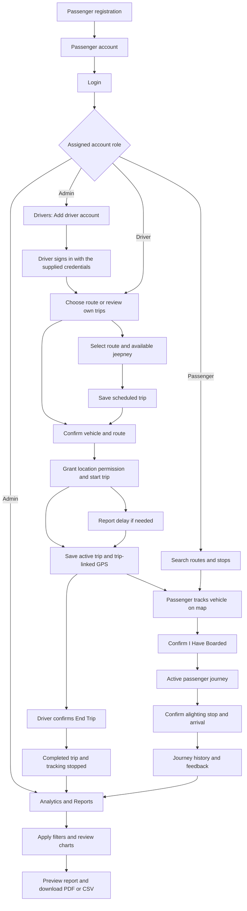
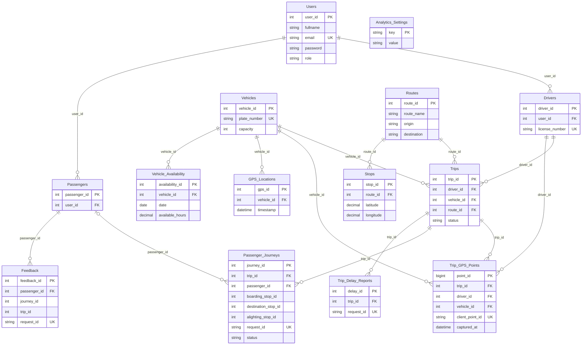

# JeepTrackWebsiteapp

**PUJ Transportation Analytics** is a jeepney tracking and transportation reporting system for Ilocos Norte. It includes mobile-first Driver and Passenger interfaces and a responsive Admin analytics website.

This repository currently demonstrates an **academic prototype**, not a confirmed deployment for a named transport operator. The workshop feedback uses the name **TransitIQ**; the implemented interface uses **PUJ Transportation Analytics**. The partner organization, final project name and responsible data owners still need confirmation.


## Technology

- Laravel 12 / PHP 8.2+ with role-scoped session & mobile bearer token authenticated APIs (`MobileBearerAuth`)
- React 18, Inertia.js and Vite
- MySQL (or SQLite for rapid local development/testing), using PHP PDO for application requests
- Mapbox GL JS for live maps with custom Zoom (`+`/`−`), Recenter (`⊕`), and route point controls, plus browser/native geolocation for driver GPS
- Native Android `.apk` wrapper (`android-app/` + `build-apk.ps1`) for **Passenger** and **Driver** roles connected to the same live database backend
- MySQL Connector/J and a Java utility for database verification and guarded imports

## Workshop feedback and evidence boundaries

The [revised information-management framework](docs/TransitIQ_IM_Workshop_Revised.md) addresses all nine sections of [the workshop feedback](TransitIQ_IM_Workshop_Feedback.pdf). It includes the actual module/CRUD inventory, dataset sources and proposed owners, confirmed three-tier architecture, centralized master-record rationale, accountability/risk matrices, report integration and a prioritized roadmap.

- The application backend is **Laravel/PHP with MySQL**. Node.js/Vite builds frontend assets; Java is an optional import/verification utility. They are not alternative backend implementations.
- Driver, vehicle and route master records use one authoritative application database. GPS is operational telemetry; browser/API validation does not make this a Hybrid MDM implementation. A complete enterprise MDM workflow is not claimed.
- Drivers choose existing registered routes for their trips; they do not create or approve master route records. Master-data corrections/approval and GPS dispute-review workflows are still proposed.
- Location updates are browser-reported. Freshness, reported accuracy and distance-quality checks do not prove physical location, sub-meter accuracy or an under-two-second delivery guarantee. Configured intervals are approximately 5 seconds for uploads and 3 seconds for passenger polling.
- There is **no implemented automatic 30-day deletion/anonymization policy**. Retention, the actual controller/privacy contact, legal purposes and organizational approvals remain to be established. No full RA 10173 compliance or measured reduction in waiting times is claimed.
- Fare transactions, hardware GPS integration, total passenger/occupancy counting and ETA prediction are not implemented. Existing analytics use recorded trips/app journeys and disclose missing observations.

The original submitted manuscript/bibliography was not supplied, so the revision provides verified primary-source references rather than claiming to have checked unavailable citations. See the framework's feedback-response checklist for open confirmations and its evidence appendix for source files.

## System flow



### Authentication and account access

Login redirects to the account's assigned role: Admin to `/admin/analytics`, Driver to `/driver/home`, and Passenger to `/passenger/home`. Public registration creates Passenger accounts only; it cannot grant Driver or Admin privileges.

To create a driver, an administrator opens **Admin → Drivers → Add driver**, enters the full name, unique email, unique license number, password and confirmation, then selects **Create driver account**. The login and linked driver record are saved together, with a hashed password. The administrator stays signed in. The driver uses the normal login page with the supplied credentials and can change their password in Profile. Creating an account does not assign a vehicle, route or trip. Admin account creation is not exposed through public registration.

Drivers can access their assigned trips and vehicle information. Passengers can access their own journeys, profile and feedback. Admin analytics endpoints require the Admin role. Password changes verify the current password, and legacy plaintext passwords are upgraded to hashes after a successful login.

### Driver flow

The bottom navigation is **Home · Trips · Tracking · Profile**.

1. Sign in using the driver account created by the administrator.
2. Open **Home** or **Trips → Set your route**. Select a registered route and the plate number of the available jeepney you will drive, then select **Save route**. This saves a scheduled trip; repeated saves for the same pending driver/vehicle trip reuse that record. Drivers with no previous assignments can use this flow too.
3. Review Trip Details, stops and vehicle. To change an existing scheduled trip, use its **Set your route** form and **Save route**. Confirm the selected vehicle and route, allow location access, and select **Start Trip** when ready.
4. The server saves the active trip and first valid GPS point together. Conflicting active trips are rejected. Passengers can now see the active trip and its recorded location.
5. Keep the browser open and visible. Valid GPS fixes are uploaded approximately every five seconds and are associated with the driver, vehicle and trip.
6. Report a delay without ending the trip, when safely stopped.
7. Confirm the destination to end the trip. Actual arrival is recorded and public GPS sharing stops. Ending a trip never fabricates passenger alighting records; passengers confirm their own actual arrival.

**Route choice today:** drivers may select any registered route before starting a trip. For example, open a scheduled **Batac–Paoay** trip, select **Batac–Laoag** under **Set your route**, and save. No per-trip Admin approval is required. The existing trip keeps its vehicle; creating a new pending trip allows selection of an available jeepney. Vehicles on active trips or reserved by another driver's scheduled trip cannot be selected. Once a trip is active, its route is locked until it ends. Completed/cancelled trips cannot be rewritten. The Admin vehicle/route/trip assignment-management screen is still not implemented.

Browser tracking can pause when the phone is locked or the page is in the background. Physical-phone GPS requires HTTPS and permission; localhost is suitable for desktop development. Passenger maps label stale GPS and unavailable ETA.

### Passenger flow

The bottom navigation is **Home · Routes · My Trip · History · Profile**.

1. Create a passenger account through public registration, or sign in to an existing passenger account.
2. Search local routes and select boarding and destination stops.
3. Track an active vehicle. Active vehicle locations refresh approximately every three seconds while the relevant page is visible. Real GPS takes priority over demo simulation; missing or stale GPS is labeled.
4. Select **I Have Boarded** and confirm the trip and stops. The server prevents duplicate active journeys.
5. View the active journey in **My Trip**. Tracking stays associated with the boarded trip, even if the vehicle is later reused for another trip.
6. Confirm the alighting stop with **I Have Arrived**. If the driver has already ended the vehicle trip, the passenger can still record their actual arrival.
7. Review journey history and submit a rating, complaint or suggestion for a completed journey.
8. Use **Joined the Wrong Trip?** to correct a mistaken boarding. The original record is retained for audit and excluded from journey totals.
9. Read saved admin responses under My Feedback. Internal admin notes are never sent to passenger browsers.

Tracking a vehicle does not reserve a seat. Seat availability and ETA are not invented when reliable observations are missing.

### Admin flow

1. Sign in with an existing Admin account.
2. Open **Drivers → Add driver** to create a driver's login and license record. The directory includes drivers who have no trips yet.
3. Review existing driver, vehicle, route and trip records. Creating a driver does not automatically create a trip; the driver can now select a route and an available jeepney on their own Home/Trips screen. Admin vehicle/route/trip creation and reassignment screens remain unimplemented.
4. Use **Live Tracking** to monitor recorded trip GPS. Demo simulations are labeled separately and stop appearing when a real GPS record takes priority or the demo assignment ends.
5. Use **Settings** to update supported analytics settings, vehicle availability and the schedule of an existing upcoming trip. Schedules cannot be changed after departure.
6. Review trips, journeys, routes, drivers and vehicles in Analytics. Apply date/route filters and inspect recorded data rather than assuming missing observations are zero.
7. Open **Feedback** to review passenger submissions, save a response, add private internal notes and update resolution status. Passengers receive the saved response, not internal notes.
8. Open **Reports** to preview the selected report and export the filtered results as PDF or CSV.

### Driver route-selection flow

1. Admin creates the driver account. Registered routes and vehicles must already exist in the database.
2. Driver opens **Home** or **Trips**, selects a route and available jeepney, then saves. Alternatively, they change the route of their own scheduled trip in Trip Details.
3. The server saves the selection as a scheduled trip. It checks driver identity, vehicle availability and conflicts; it never fabricates GPS or publishes an active vehicle just because a route was saved.
4. Driver starts the trip with a fresh GPS fix. The saved route, vehicle and driver become the active trip that passengers see and track.
5. Driver ends that trip before selecting another route. The historical trip, GPS and passenger journeys retain their original links.

This is implemented driver-side route choice, not an Admin approval/request workflow. There is no approved-route permissions table or route-change approval queue. After a route changes, old scheduled-arrival/direction values are cleared because they may describe the previous route.

### Admin analytics and reports

| Page | URL | Purpose |
| --- | --- | --- |
| Overview | `/admin/analytics` | Completed trips, journeys, travel duration and arrival delays |
| Route Analytics | `/admin/analytics/routes` | Route demand, paired scheduled/actual duration and reliability |
| Passenger Analytics | `/admin/analytics/passengers` | Recorded journeys, unique registered passengers and boarding patterns |
| Driver Performance | `/admin/analytics/drivers` | Driver activity, departure punctuality and arrival delay |
| Vehicle Utilization | `/admin/analytics/vehicles` | Operating hours, available hours, estimated distance and GPS coverage |
| Feedback Analytics | `/admin/analytics/feedback` | Ratings, categories, resolution status and satisfaction trends |
| Reports Center | `/admin/reports` | Filtered previews and downloadable PDF/CSV reports |

Filters, grouping, search, sorting, pagination and exports use shared metric helpers. Refresh reads MySQL, and visible admin pages refresh automatically every 30 seconds. The Reports Center supports Trip Summary, Route Analytics, Passenger Analytics, Driver Performance, Vehicle Utilization and Feedback Summary reports.

Under `/admin/settings`, administrators can save the delay threshold, date-specific available vehicle hours and upcoming trip schedules. Historical schedules cannot be changed after departure. `/admin/feedback` includes undated legacy submissions and supports saved replies, private internal notes and resolution status.

## Database relationships and how they work

`Users` stores the login account and role. `Drivers` and `Passengers` store the role-specific records. `Trips` connects a driver, a vehicle and a route for one departure. GPS points and passenger journeys then attach to that trip, so a later trip using the same jeepney does not replace its history.

A **primary key (PK)** identifies a row, such as `trip_id`. A **foreign key (FK)** points to an existing row in another table, such as `Trips.driver_id` pointing to `Drivers.driver_id`.

### Database relationship diagram

The diagram below shows the foreign-key relationships declared in the supplied schema and additive migrations. One parent can have zero or many child records. Additional application-validated links are described after the diagram.



`UK` means a unique key. `Vehicle_Availability` also has a combined unique key on `(vehicle_id, date)`. `Analytics_Settings` is a standalone key/value table, so it has no foreign-key line in the diagram. An Admin is a `Users` row with `role = Admin`; there is no separate Admin table.

The application treats each Driver or Passenger account as having one corresponding role-specific profile. However, the imported schema does **not** declare `Drivers.user_id` or `Passengers.user_id` unique. The diagram therefore shows what the database permits, rather than claiming it enforces a one-to-one relationship.

### What each connection means

| Connection | How the application uses it |
| --- | --- |
| `Users → Drivers` | Connects a driver's email/password login to their license record. Trips use `driver_id`, not `user_id`. |
| `Users → Passengers` | Connects a passenger's login to their own journeys and feedback. |
| `Drivers + Vehicles + Routes → Trips` | Records who drives which jeepney on which route for a particular trip. A driver or vehicle can have many historical trips. |
| `Routes → Stops` | Groups boarding/destination stops under a route. Stop order is not currently stored. |
| `Trips → Trip_GPS_Points` | Stores the actual fixes for a particular trip, including the driver, vehicle, accuracy and capture time. |
| `Vehicles → GPS_Locations` | Retains a compatibility copy of GPS fixes for existing tools. This table alone does not identify the trip; trip tracking uses `Trip_GPS_Points`. |
| `Passengers + Trips → Passenger_Journeys` | Connects one passenger's boarding/arrival record to the vehicle trip they actually boarded. Many passengers can have journeys on the same trip. |
| `Passengers → Feedback` | Identifies who submitted feedback. New submissions also save `journey_id` and `trip_id` so analytics can identify the route, driver and vehicle through that trip. |
| `Trips → Trip_Delay_Reports` | Stores delay reports without changing the active trip into a completed trip. |
| `Vehicles → Vehicle_Availability` | Stores available operating hours by vehicle and date for utilization calculations. |

Passenger journey stop IDs refer to `Stops.stop_id`, but the migration does not declare foreign keys for those three stop columns. The boarding/arrival APIs validate that the selected stops belong to the trip's route. Likewise, `Feedback.journey_id` and `Feedback.trip_id` are application-managed links without declared database foreign keys in the current migration; new feedback is created through the passenger's own completed journey. Legacy feedback may have neither link.

### Example: one complete trip

The following IDs are an explanation, not additional seed data:

1. Admin creates a driver account: `Users.user_id = 20`, `role = Driver`, and a linked `Drivers.driver_id = 7` with `user_id = 20`.
2. An existing assignment in `Trips` might contain `trip_id = 50`, `driver_id = 7`, `vehicle_id = 3`, `route_id = 1`, and `status = Scheduled`. The route record identifies, for example, **Batac–Laoag**. The account creation form does not create this assignment.
3. When that driver starts trip 50, the server checks ownership and the assigned vehicle/route, marks it `In Progress`, and saves a `Trip_GPS_Points` row with those same trip/driver/vehicle IDs.
4. A signed-in passenger receives the active trip and its latest valid trip-linked location. New fixes update the displayed position; they do not create new trips.
5. Boarding creates a `Passenger_Journeys` row containing that passenger's `passenger_id`, `trip_id = 50`, and selected stop IDs. The vehicle trip and passenger journey have separate statuses.
6. Passenger arrival completes their journey. Driver End Trip completes the vehicle trip and stops public GPS. Neither action invents the other person's arrival record.
7. Feedback links back to the completed passenger journey and trip. Admin reports join these records to calculate route, driver, vehicle and passenger metrics.

The APIs enforce assignment ownership, one active trip per driver/vehicle, and one active journey per passenger. These are application rules, not permanent driver-to-route relationships. `Drivers` has no assigned `route_id` or `vehicle_id`; those connections are stored per trip in `Trips`. Drivers can create scheduled trips and change their own scheduled trip route through the route-selection APIs. An Admin-approved-route permissions list or route-change request queue would need an additional data model and does not exist.

### Records versus calculated analytics

Charts and reports are calculated from the linked operational records; there is no separate table for each chart. Completed trip timestamps supply duration, journey timestamps supply travel-hour/boarding patterns, feedback supplies ratings, and vehicle availability supplies utilization denominators. Unique request IDs prevent duplicate GPS, boarding, feedback and delay submissions. Simulation positions are generated separately and are not inserted into the real GPS tables.

Schema sources: [base tables](database/transport_system.sql), [trip GPS migration](database/migrations/2026_10_25_000100_add_trip_gps_tracking.php), and [journey/analytics migration](database/migrations/2026_10_25_000200_add_analytics_records.php).

## Data and calculation rules

- Completed trips come from trip records whose status is Completed.
- Reporting dates use Asia/Manila. New operational timestamps are stored in UTC; legacy DATETIME values are interpreted as Asia/Manila.
- Journey totals use recorded boarding/journey records; correction records are excluded. Request IDs and active-journey checks prevent duplicate submissions.
- Unique registered passengers are distinct registered passenger IDs, not journey counts. Anonymous manual counts are not currently collected.
- Actual duration requires valid actual departure and arrival timestamps.
- Departure punctuality and arrival delay are separate metrics. Both use the configured delay threshold.
- Driver duration comparisons require a selected route. A delay is not automatically attributed to the driver.
- Vehicle utilization requires configured available operating hours for every selected vehicle-day. Missing or zero denominators do not produce a utilization percentage.
- GPS-derived distance is estimated. Poor accuracy, implausible jumps and gaps over 120 seconds are excluded; incomplete coverage is flagged.
- Feedback without submission dates is excluded from date-filtered analytics. Historical missing dates, schedules, journeys and GPS are not fabricated.
- Sample records are labeled **Demo data**. Local sample routes include Batac–Laoag, Batac–Paoay, Paoay–Laoag, Laoag–San Nicolas and San Nicolas–Batac. These are illustrative records, not an official terminal registry.

## Setup, Installation & Running Guide

### 1. Prerequisites

Ensure the following tools are installed on your machine:

- **PHP 8.2+** (with `pdo_mysql`, `pdo_sqlite`, `mbstring`, `openssl`, `fileinfo` enabled)
- **Composer 2.x**
- **Node.js 20.19+ or 22.12+** & **npm**
- **MySQL 8.0+** (or SQLite for quick local testing)
- **Java JDK 11+** *(required for the guarded MySQL Connector/J importer and Android APK signing)*
- **Android SDK Build-Tools 34+ & Platform 34+** *(optional — only needed if rebuilding `JeepTrack.apk` from source via `build-apk.ps1`; a pre-built signed APK is already included at `public/downloads/JeepTrack.apk`)*

---

### 2. Clone & Install Dependencies

Open PowerShell or your terminal in the project root and run:

```powershell
# 1. Clone the repository (if not already cloned)
git clone https://github.com/misakishon/JeepTrackWebsiteapp.git
cd JeepTrackWebsiteapp

# 2. Install PHP backend dependencies
composer install

# 3. Install Node.js frontend dependencies
npm ci

# 4. Create your local environment file and generate the app key
Copy-Item .env.example .env
php artisan key:generate
```

---

### 3. Configure `.env`

Open `.env` and configure your database connection, application URL, and Mapbox token:

```dotenv
APP_NAME="PUJ Transportation Analytics"
APP_URL=http://127.0.0.1:8000

DB_CONNECTION=mysql
DB_HOST=127.0.0.1
DB_PORT=3306
DB_DATABASE=PUJ
DB_USERNAME=your_mysql_user
DB_PASSWORD="your_mysql_password"

SESSION_DRIVER=file
CACHE_STORE=file
QUEUE_CONNECTION=sync

TRANSPORT_DATABASE_ENABLED=true
TRANSPORT_SAMPLE_DATA=true
# Pre-configured encrypted Mapbox token (JT_ENC:...) is included in .env.example and decrypted automatically at runtime:
VITE_MAPBOX_ACCESS_TOKEN=JT_ENC:...
JAVA_BINARY=java
```

> **Note:** Keep `.env` private. `.env.example` already includes the shared encrypted `VITE_MAPBOX_ACCESS_TOKEN` (`JT_ENC:...`), which [`mapboxTokenCipher.js`](resources/js/Components/mapboxTokenCipher.js) decrypts automatically at runtime so anyone who clones the repository and copies `.env.example` to `.env` gets working live Mapbox maps immediately without exposing a raw `pk.eyJ...` token in plaintext.

---

### 4. Database Initialization & Migrations

#### Option A: Fresh MySQL Database (Recommended)
Create an empty MySQL database named `PUJ` (or the name set in `DB_DATABASE`), then run the guarded importer to load the base schema and sample data safely:

```powershell
php artisan config:clear

# Verify database connection and target readiness
php artisan transport:import --check

# Import base transport schema & sample data into the empty database
php artisan transport:import
```

*(If Java is not installed, you can verify or import using PHP PDO via `php artisan transport:import --connector=pdo`.)*

#### Option B: Existing Compatible PUJ Database
Skip `php artisan transport:import` so existing records are preserved, and apply only the additive migrations below.

#### Apply Additive Feature Migrations (Required for Both Options)
Run the additive migrations in order to add trip GPS tracking, passenger journeys, analytics tables, and mobile bearer token (`api_token`) support:

```powershell
php artisan migrate --path=database/migrations/2026_10_25_000100_add_trip_gps_tracking.php
php artisan migrate --path=database/migrations/2026_10_25_000200_add_analytics_records.php
php artisan migrate --path=database/migrations/2026_10_26_000100_add_api_token_to_users.php
```

> **Important:** Do **not** run `php artisan migrate:fresh` against an imported `PUJ` database, as the default Laravel starter migrations do not represent the imported `transport_system.sql` schema.

---

### 5. Build Frontend Assets & Run the Application

#### Development Mode (Hot Reload)
Open **two terminals** in the project root:

**Terminal 1 — Laravel Backend & API Server:**
```powershell
# Bind to 0.0.0.0 so both your PC browser and Android phones on the same Wi-Fi can connect
php artisan serve --host=0.0.0.0 --port=8000
```

**Terminal 2 — Vite Frontend Dev Server:**
```powershell
npm run dev
```

#### Production Bundle Mode (Single Server)
If you build the frontend bundle first, you only need `php artisan serve`:

```powershell
npm run build
php artisan serve --host=0.0.0.0 --port=8000
```

Now open **`http://127.0.0.1:8000/login`** in your browser:
- **Passenger Home:** `http://127.0.0.1:8000/passenger/home`
- **Driver Home:** `http://127.0.0.1:8000/driver/home`
- **Admin Analytics Dashboard:** `http://127.0.0.1:8000/admin/analytics`
- **Direct APK Download:** `http://127.0.0.1:8000/download/apk`

---

### 6. Installing & Running the Android `.apk` (Passenger & Driver App)

The Android app (`JeepTrack.apk`) provides the exact mobile UI for **Passenger** and **Driver** accounts only (Admin accounts are blocked on the mobile `.apk` and directed to the web dashboard) and connects directly to the same live database as the website.

#### A. Download & Install the `.apk`
1. **From the Website UI:** Open `/login`, `/passenger/home`, or `/driver/home` and click the **"Download .APK"** button on the **JeepTrack Mobile App** card (or visit `http://<your-server-ip>:8000/download/apk` directly on your Android phone).
2. **From the Project Folder:** Copy `JeepTrack.apk` (or `public/downloads/JeepTrack.apk`) to your Android device via USB or file share.
3. Open the `.apk` on your Android phone, allow **"Install unknown apps"** if prompted, and launch **JeepTrack**.

#### B. Connect the `.apk` to Your Database Server
1. Ensure your computer is running `php artisan serve --host=0.0.0.0 --port=8000` and that your phone is connected to the **same Wi-Fi network** (or use an Android Emulator).
2. Find your computer's local LAN IP address by running `ipconfig` in PowerShell (e.g., `192.168.1.15`).
3. On the JeepTrack app's **Login** screen, tap **"Database Server Connection"** at the bottom:
   - **Real Android Phone on Same Wi-Fi:** Enter `http://192.168.1.15:8000` (replace with your PC's IPv4 address).
   - **Android Studio Emulator:** Enter `http://10.0.2.2:8000` (default).
   - **USB Debugging (`adb reverse tcp:8000 tcp:8000`):** Enter `http://127.0.0.1:8000`.
4. Tap **Save & Test** — once confirmed, sign in with any **Passenger** or **Driver** database account. All trips, live GPS updates, route changes, boardings, and feedback sync in real time with the website and Admin Analytics dashboard.

#### C. Rebuilding `JeepTrack.apk` After UI Changes
Whenever you modify React/CSS files and want to update the packaged `.apk`:

```powershell
powershell -ExecutionPolicy Bypass -File .\build-apk.ps1
```

This script runs `npm run build`, syncs the compiled assets into `android-app/`, compiles the native Android WebView bridge (`MainActivity.java`), aligns the package with `zipalign`, signs it with `apksigner`, and outputs the updated APK to both `public/downloads/JeepTrack.apk` and `JeepTrack.apk`.

---

### 7. Viewing Phone Mode on Desktop Without Opening Inspect (`F12`)

- **Built-in Phone Frame:** Simply open `http://127.0.0.1:8000/login` or `/passenger/home` on a regular desktop browser window — the app automatically renders inside a centered `560px` mobile phone frame alongside the desktop rail.
- **Standalone App Window:** Run the following command in PowerShell to launch a frameless mobile-sized window (`412×880`) with no address bar or DevTools:
  ```powershell
  Start-Process msedge -ArgumentList "--app=http://127.0.0.1:8000/passenger/home --window-size=412,880"
  ```

---

## Main application endpoints

| Area | Endpoints |
| --- | --- |
| Authentication (Web & Mobile Bearer) | `POST /login`, `POST /register`, `POST /logout` |
| Mobile Connectivity & APK Download | `GET /api/mobile/ping`, `GET /download/apk` |
| Role-scoped data | `GET /api/transport/snapshot`, `GET /api/transport/trips/{id}` |
| Driver route selection | `POST /api/transport/trips` (route and available vehicle), `PATCH /api/transport/trips/{id}/route` (own scheduled trip) |
| Driver trip operations | `POST /api/transport/trips/{id}/start`, `/gps`, `/end`, `/delay` |
| Passenger journeys | `POST /api/transport/journeys`, `POST /api/transport/journeys/{id}/arrive`, `/correct`, `/feedback` |
| Account | `PATCH /api/transport/profile`, `PUT /api/transport/password` |
| Admin analytics | `GET /api/admin/analytics` |
| Driver account management | `GET /api/admin/drivers`, `POST /api/admin/drivers` (Admin only) |
| Analytics configuration | `PUT /api/admin/analytics/settings`, `/availability`, `/trips/{id}/schedule` |
| Feedback review | `PATCH /api/admin/analytics/feedback/{id}` |

All operational endpoints require authentication, appropriate role and record ownership checks. Browser requests use Laravel session authentication and CSRF protection; Android `.apk` requests authenticate against the same endpoints using `Authorization: Bearer <token>` via `MobileBearerAuth`.

## Project structure

```text
android-app/                Native Android WebView project & manifest for JeepTrack.apk
app/Http/Controllers/       Authentication, trip/GPS, journey and analytics APIs
app/Http/Middleware/        MobileBearerAuth middleware for Android APK bearer tokens
app/Models/                 Models mapped to the supplied MySQL schema
app/Services/               Database serialization, analytics, tracking and import logic
build-apk.ps1               Automated Vite + Android SDK APK build & signing script
database/migrations/        Additive tracking, analytics, and mobile token migrations
database/transport_system.sql  Local sample schema/data source
public/downloads/           Signed downloadable JeepTrack.apk served at /download/apk
resources/js/Pages/         Driver, Passenger and Admin interfaces
resources/js/Components/    Shared map, icons, APK download card, and UI components
resources/js/admin/         Analytics calculations, charts, settings and exports
resources/js/hooks/         Browser & mobile GPS lifecycle
routes/web.php              Web pages, APK download route, and authenticated API routes
tests/Feature/              Isolated backend & mobile APK authentication feature tests
tests/ui/                   Analytics and export calculation tests
tools/mysql/                Java Connector/J utility
```

## Verification

```powershell
php artisan test --filter="DriverRouteSelectionTest|DriverAccountsTest|AccountConnectionTest|AnalyticsRecordsTest|TransportDatabaseTest|TripTrackingTest|DemoSimulationTest|MobileApkAndAuthTest"
node --test tests/ui/analytics-data.test.mjs
npm run build
```

The focused PHP tests use isolated in-memory SQLite fixtures, not the running MySQL database. The current focused checks cover role isolation, mobile APK bearer authentication & Admin role restriction, GPS/trip lifecycle, journey deduplication, feedback privacy, schedules, operating hours and analytics calculations.

## Current limitations

Email delivery/verification and password recovery, saved notification preferences, manual passenger counting, contact-number storage, reliable occupancy information and an ETA prediction service are not connected. Driver route choice is available before trip start. Route-change approval and Admin vehicle/route/trip assignment management are not implemented. Driver account creation is available, but other administrative directory pages remain read-only. Browser GPS cannot guarantee background tracking. A physical-phone road test is still required before operational use.

See [MYSQL_SETUP.md](MYSQL_SETUP.md) for database integration details and implementation history.
