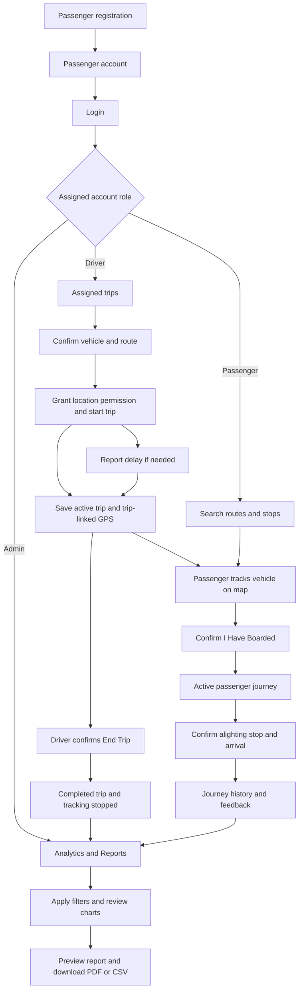

# JeepTrackWebsiteapp

**PUJ Transportation Analytics** is a jeepney tracking and transportation reporting system for Ilocos Norte. It includes mobile-first Driver and Passenger interfaces and a responsive Admin analytics website.


## Technology

- Laravel 12 / PHP 8.2+ with role-scoped authenticated APIs
- React 18, Inertia.js and Vite
- MySQL, using PHP PDO_MYSQL for application requests
- Mapbox GL JS for maps and browser geolocation for driver GPS
- MySQL Connector/J and a Java utility for database verification and guarded imports

## System flow



### Authentication and account access

Login redirects to the account's assigned role. Public registration creates Passenger accounts only; it cannot grant Driver or Admin privileges. Driver and Admin roles are controlled administratively. A self-service driver provisioning screen is not currently implemented.

Drivers can access their assigned trips and vehicle information. Passengers can access their own journeys, profile and feedback. Admin analytics endpoints require the Admin role. Password changes verify the current password, and legacy plaintext passwords are upgraded to hashes after a successful login.

### Driver flow

The bottom navigation is **Home · Trips · Tracking · Profile**.

1. Review the assigned vehicle, route, stops and upcoming trip.
2. Confirm the assignment and allow location access before starting.
3. The server saves the active trip and first valid GPS point together. Conflicting active trips are rejected.
4. Keep the browser open and visible. Valid GPS fixes are uploaded approximately every five seconds and are associated with the driver, vehicle and trip.
5. Report a delay without ending the trip, when safely stopped.
6. Confirm the destination to end the trip. Actual arrival is recorded and GPS sharing stops. Ending a trip never fabricates passenger alighting records.

Browser tracking can pause when the phone is locked or the page is in the background. Physical-phone GPS requires HTTPS and permission; localhost is suitable for desktop development. Passenger maps label stale GPS and unavailable ETA.

### Passenger flow

The bottom navigation is **Home · Routes · My Trip · History · Profile**.

1. Search local routes and select boarding and destination stops.
2. Track an active vehicle. Active vehicle locations refresh approximately every three seconds while the relevant page is visible.
3. Select **I Have Boarded** and confirm the trip and stops. The server prevents duplicate active journeys.
4. View the active journey in My Trip. Confirm the alighting stop with **I Have Arrived**.
5. Review journey history and submit a rating, complaint or suggestion for a completed journey.
6. Use **Joined the Wrong Trip?** to correct a mistaken boarding. The original record is retained for audit and excluded from journey totals.
7. Read saved admin responses under My Feedback. Internal admin notes are never sent to passenger browsers.

Tracking a vehicle does not reserve a seat. Seat availability and ETA are not invented when reliable observations are missing.

### Admin analytics and reports

| Page | URL | Purpose |
| --- | --- | --- |
| Overview | `/admin/analytics` | Completed trips, journeys, travel duration and arrival delays |
| Route Analytics | `/admin/analytics/routes` | Route demand, paired scheduled/actual duration and reliability |
| Passenger Analytics | `/admin/analytics/passengers` | Recorded journeys, unique registered passengers and boarding patterns |
| Driver Performance | `/admin/analytics/drivers` | Driver activity, departure punctuality and arrival delay |
| Vehicle Utilization | `/admin/analytics/vehicles` | Operating hours, available hours, estimated distance and GPS coverage |
| Feedback Analytics | `/admin/analytics/feedback` | Ratings, categories, resolution status and satisfaction trends |
| Reports Center | `/admin/reports` | Filtered previews and downloadable PDF/CSV reports |

Filters, grouping, search, sorting, pagination and exports use shared metric helpers. Refresh reads MySQL, and visible admin pages refresh automatically every 30 seconds. The Reports Center supports Trip Summary, Route Analytics, Passenger Analytics, Driver Performance, Vehicle Utilization and Feedback Summary reports.

Under `/admin/settings`, administrators can save the delay threshold, date-specific available vehicle hours and upcoming trip schedules. Historical schedules cannot be changed after departure. `/admin/feedback` includes undated legacy submissions and supports saved replies, private internal notes and resolution status.

## Data and calculation rules

- Completed trips come from trip records whose status is Completed.
- Reporting dates use Asia/Manila. New operational timestamps are stored in UTC; legacy DATETIME values are interpreted as Asia/Manila.
- Journey totals use recorded boarding/journey records; correction records are excluded. Request IDs and active-journey checks prevent duplicate submissions.
- Unique registered passengers are distinct registered passenger IDs, not journey counts. Anonymous manual counts are not currently collected.
- Actual duration requires valid actual departure and arrival timestamps.
- Departure punctuality and arrival delay are separate metrics. Both use the configured delay threshold.
- Driver duration comparisons require a selected route. A delay is not automatically attributed to the driver.
- Vehicle utilization requires configured available operating hours for every selected vehicle-day. Missing or zero denominators do not produce a utilization percentage.
- GPS-derived distance is estimated. Poor accuracy, implausible jumps and gaps over 120 seconds are excluded; incomplete coverage is flagged.
- Feedback without submission dates is excluded from date-filtered analytics. Historical missing dates, schedules, journeys and GPS are not fabricated.
- Sample records are labeled **Demo data**. Local sample routes include Batac–Laoag, Batac–Paoay, Paoay–Laoag, Laoag–San Nicolas and San Nicolas–Batac. These are illustrative records, not an official terminal registry.

## Local setup

### Requirements

Install PHP 8.2+ with PDO_MYSQL and SQLite support for tests, Composer, Node.js 20.19+ or 22.12+, and MySQL 8. Java 11+ is required when using the Connector/J utility.

```powershell
composer install
npm ci
Copy-Item .env.example .env
php artisan key:generate
```

Configure your local `.env`:

```dotenv
APP_NAME="PUJ Transportation Analytics"
APP_URL=http://127.0.0.1:8000
DB_CONNECTION=mysql
DB_HOST=127.0.0.1
DB_PORT=3306
DB_DATABASE=PUJ
DB_USERNAME=your_mysql_user
DB_PASSWORD="your_mysql_password"
SESSION_DRIVER=file
CACHE_STORE=file
QUEUE_CONNECTION=sync
TRANSPORT_DATABASE_ENABLED=true
TRANSPORT_SAMPLE_DATA=true
VITE_MAPBOX_ACCESS_TOKEN=your_mapbox_public_access_token
JAVA_BINARY=java
```

Keep `.env` private. Use your own Mapbox public token with appropriate URL restrictions. Database credentials and application login credentials are separate.

### Database initialization

For an **existing compatible database**, configure the connection and apply only the additive feature migrations below. Do not reimport its sample data.

For a **new installation**, first create an empty MySQL database and configure `.env`. The supplied SQL includes legacy destructive statements: use the guarded importer instead of executing that SQL directly against an existing database.

```powershell
php artisan config:clear
php artisan transport:import --check
# New empty database only:
php artisan transport:import
```

The importer uses the supplied `mysql-connector-j-26.7.0.jar`, strips destructive statements, hashes seed passwords and refuses a populated target. Set `JAVA_BINARY` to your Java executable and `MYSQL_JDBC_JAR` if the JAR is stored elsewhere. PHP connectivity can also be checked with `php artisan transport:import --connector=pdo --check`.

Apply the feature migrations in order:

```powershell
php artisan migrate --path=database/migrations/2026_10_25_000100_add_trip_gps_tracking.php
php artisan migrate --path=database/migrations/2026_10_25_000200_add_analytics_records.php
```

The original Laravel starter migrations do not describe the imported transport schema. Do not use an unrestricted migrate or migrate:fresh command for an existing PUJ database. The transport migrations preserve existing records.

### Run the application

Use two terminals:

```powershell
php artisan serve --host=127.0.0.1 --port=8000
```

```powershell
npm run dev
```

Open `http://127.0.0.1:8000/login`. Sign in with an account provisioned in your database. Public registration is available for passengers.

For a production asset build:

```powershell
npm run build
```

Production deployment also requires a configured PHP web server, HTTPS, private environment configuration, writable Laravel runtime directories and production-appropriate database accounts. The development server is not a production deployment.

## Main application endpoints

| Area | Endpoints |
| --- | --- |
| Authentication | `POST /login`, `POST /register`, `POST /logout` |
| Role-scoped data | `GET /api/transport/snapshot`, `GET /api/transport/trips/{id}` |
| Driver trip operations | `POST /api/transport/trips/{id}/start`, `/gps`, `/end`, `/delay` |
| Passenger journeys | `POST /api/transport/journeys`, `POST /api/transport/journeys/{id}/arrive`, `/correct`, `/feedback` |
| Account | `PATCH /api/transport/profile`, `PUT /api/transport/password` |
| Admin analytics | `GET /api/admin/analytics` |
| Analytics configuration | `PUT /api/admin/analytics/settings`, `/availability`, `/trips/{id}/schedule` |
| Feedback review | `PATCH /api/admin/analytics/feedback/{id}` |

All operational endpoints require authentication, appropriate role and record ownership checks. Browser requests use Laravel session authentication and CSRF protection.

## Project structure

```text
app/Http/Controllers/       Authentication, trip/GPS, journey and analytics APIs
app/Models/                 Models mapped to the supplied MySQL schema
app/Services/               Database serialization, analytics, tracking and import logic
database/migrations/        Additive tracking and analytics schema extensions
database/transport_system.sql  Local sample schema/data source
resources/js/Pages/         Driver, Passenger and Admin interfaces
resources/js/Components/    Shared map, icons and UI components
resources/js/admin/         Analytics calculations, charts, settings and exports
resources/js/hooks/         Browser GPS lifecycle
routes/web.php              Web pages and authenticated API routes
tests/Feature/              Isolated backend feature tests
tests/ui/                   Analytics and export calculation tests
tools/mysql/                Java Connector/J utility
```

## Verification

```powershell
php artisan test --filter='AnalyticsRecordsTest|TransportDatabaseTest|TripTrackingTest'
node --test tests/ui/analytics-data.test.mjs tests/ui/analytics-live-data.test.mjs
npm run build
```

The focused PHP tests use isolated in-memory SQLite fixtures, not the running MySQL database. The current focused checks cover role isolation, GPS/trip lifecycle, journey deduplication, feedback privacy, schedules, operating hours and analytics calculations. Unmodified Laravel scaffold tests are not the transport application's acceptance suite.

## Current limitations

Email delivery/verification and password recovery, saved notification preferences, manual passenger counting, contact-number storage, reliable occupancy information and an ETA prediction service are not connected. Some administrative directory pages remain read-only. Browser GPS cannot guarantee background tracking. A physical-phone road test is still required before operational use.

See [MYSQL_SETUP.md](MYSQL_SETUP.md) for database integration details and implementation history.
