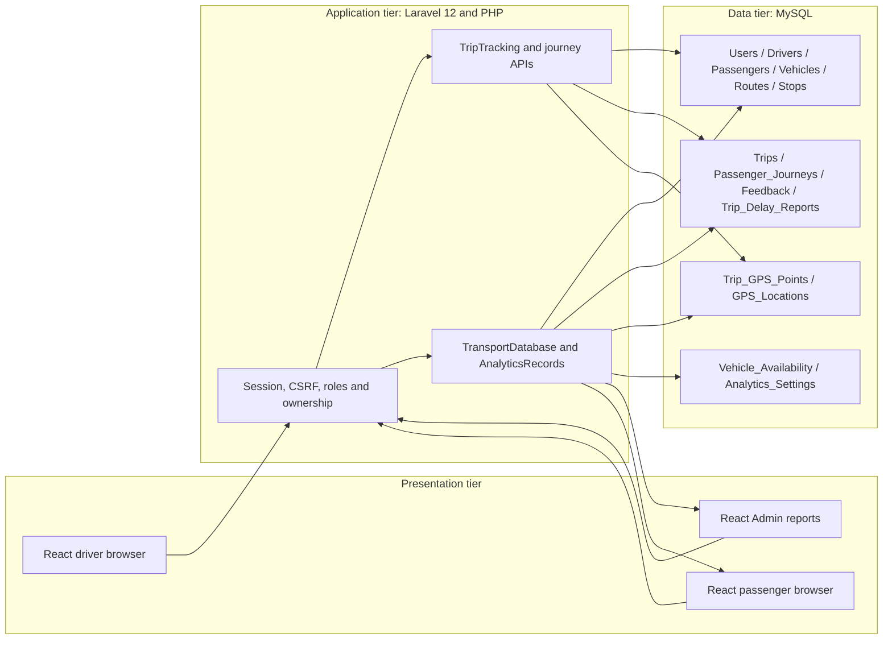

# TransitIQ: revised information-management framework

Revision date: 28 October 2026. Based on the two-page **Preliminary IM Workshop Feedback**, preliminary manuscript score **76/100**. This document is an implementation-grounded replacement draft, not a new assessment score or certification.

**Naming:** the feedback calls the project TransitIQ; the implemented application is branded **PUJ Transportation Analytics**, in the `JeepTrackWebsiteapp` repository. This draft treats those as the manuscript and application names of the same prototype. The project team should confirm the final submission title rather than silently renaming the application.

**Setting and organization:** an academic prototype for jeepney operations around Batac, Laoag, Paoay and San Nicolas, Ilocos Norte. A partner operator/cooperative, official data custodian and deployment site have **not been confirmed in the supplied material**. No affiliation with a named operator, terminal, regulator or local government is asserted. Confirm those details before describing a real organizational deployment.

**Evidence boundary:** the feedback PDF and the current repository were available. The original submitted manuscript, its bibliography, interviews and earlier risk matrices were not supplied. This draft cannot certify their contents or verify undocumented partnerships. Status labels below distinguish implemented code, demonstrated test behavior and proposed organizational controls.

## I. Introduction and bounded objectives

The prototype demonstrates how driver, vehicle and route records can be linked to trip operations, browser-reported vehicle locations, passenger journeys and transportation reports in one application. Its users are administrators, registered drivers and registered passengers. The intended operating setting is local jeepney service; production adoption by a particular organization remains unconfirmed.

The demonstrable objectives are to:

1. Authenticate the three roles and limit account, trip and journey operations by role and ownership.
2. Let Admin create driver accounts and let drivers select an existing route and available jeepney for a scheduled trip.
3. Start/end trips with real database writes, accept browser GPS fixes while a driver shares location, and show active-vehicle positions to signed-in passengers.
4. Save passenger boarding, arrival, corrections and feedback against the trip actually used.
5. Produce filtered reports from available trip, journey, schedule, availability and feedback records, while identifying missing observations.

Dedicated GPS hardware, total passenger counts, fares/payments, ETA prediction, continuous background tracking, fraud-proof location and measured reductions in waiting time are **outside the demonstrated scope**. AI is optional in the feedback and is not required for this revision.

## II. Organizational profile, module inventory and data provenance

### Stakeholders and accountable roles

- **Administrator:** manages supported account/configuration/feedback operations and reviews operational records. This technical role is not evidence that an operator has formally appointed a data steward or privacy officer.
- **Driver:** selects a trip route and available vehicle, confirms the trip, supplies browser-reported fixes, reports delays and ends the trip.
- **Passenger:** selects a service and stops, confirms boarding/arrival, views their journey history and submits feedback.
- **Project team:** maintains the prototype, test fixtures, schema and documentation. It is the current technical custodian, not a confirmed real-world transport operator.
- **Proposed partner operator:** would approve operational master data, processing purposes, retention and production access. Organization and responsible people must still be named.

### What is implemented

| Module | Current implementation | Boundary |
| --- | --- | --- |
| Authentication/accounts | Login/logout, passenger registration, Admin-created driver accounts, profile/password updates | No public Driver/Admin self-registration; email verification/recovery not connected |
| Driver/vehicle/route records | Central MySQL records and read views; driver account creation writes Users and Drivers together | Not a complete master-data CRUD suite: vehicle/route editing, correction approval and deletion screens are missing |
| Driver route choice | Save a registered route and available vehicle; update an owned scheduled trip's route | Not approval of a new master route; no approved-route permission list or request queue |
| Trip operations | Scheduled/In Progress/Completed/Cancelled records; start, GPS upload, delay and end APIs | Active/historical routes cannot be edited through the route-choice API |
| GPS | Browser Geolocation API, trip-linked storage, stale labels, passenger/fleet maps | No hardware tracker integration or proof of location authenticity |
| Passenger journeys | Registered-account boarding, arrival, correction and own history | Not a total physical occupancy count; anonymous/manual passengers are excluded |
| Fare transactions | None | No fare transaction table, payment integration or revenue report |
| Analytics/export | Route/trip/journey/driver/vehicle/feedback metrics, PDF/CSV | Derived from recorded observations; no validated ETA or road-segment bottleneck model |
| Privacy/governance | Role checks and specific safeguards described below | No certified legal compliance, automatic retention or formal dispute workflow |

### Dataset source and owner/steward register

The ownership column identifies accountability that must be confirmed for deployment; it does not remove a person's rights over their personal data.

| Dataset | Actual current source | Proposed accountable owner / steward | Evidence or limitation |
| --- | --- | --- | --- |
| Users, Drivers, Passengers | Registration, Admin driver creation, imported sample account records | Partner operator as controller, if confirmed; Admin as operational steward | Email/license uniqueness is checked; identity and license validity are not externally verified |
| Vehicles | Supplied sample SQL/import and existing MySQL rows | Fleet owner/operator; designated Admin steward | No authoritative fleet-registry integration or complete correction UI |
| Routes and Stops | Supplied/localized sample records and route-coordinate configuration | Operator/route coordinator; named approver pending | Illustrative local records, not verified official route permissions or terminal registry |
| Trips | Existing/imported assignments and authenticated driver trip planning/start/end | Operator operations lead; driver responsible for submissions | Current account role permits route selection without per-trip Admin approval |
| Trip_GPS_Points | Driver browser coordinates and client timestamps | Operator/controller if confirmed; authorized tracking administrator | Client-reported telemetry; controlled browser callbacks were used in automated end-to-end tests |
| GPS_Locations | Compatibility copy written from accepted driver fixes | Same owner/steward as trip GPS | Not an independent sensor or second authoritative location source |
| Passenger_Journeys | Passenger boarding/arrival/correction confirmations | Operator/controller if confirmed; passenger is the submitting data subject | Self-reported app journeys, not independently observed boarding counts |
| Feedback / Trip_Delay_Reports | Passenger submissions / assigned driver submissions | Service-quality or operations lead; Admin reviewer | Private review notes excluded from passenger responses; no dedicated GPS dispute case system |
| Vehicle_Availability / Analytics_Settings | Authorized Admin inputs | Operations lead; Admin configuration steward | Utilization depends on these configured denominators |
| Charts / PDF / CSV | Computation over the above tables | Authorized report user and the eventual controller | Exported copies need their own handling/retention controls |

Historical seeded rows and demo simulations must remain visibly distinguished from actual operational observations. `TRANSPORT_SAMPLE_DATA` is a label/control setting, not evidence of field deployment or authentic measurements.

## III. Confirmed three-tier architecture and database

### Architecture

React 18 and Inertia.js provide the interface. Laravel/PHP serves pages and authenticated APIs. MySQL through PDO is the application DBMS. Vite/Node.js build frontend assets; Node.js is **not** an Express backend. Java Connector/J is an optional verification/import utility, **not** the application server. Mapbox supplies mapping; it is not the master database. No PostgreSQL backend is implemented.

### Main identifiers and relationships

| Tables | Identifiers and purpose |
| --- | --- |
| Users / Drivers / Passengers | `user_id`, `driver_id`, `passenger_id`; role-specific profiles link back to Users |
| Vehicles / Routes / Stops | `vehicle_id`, `route_id`, `stop_id`; stops belong to a route |
| Trips | `trip_id` joins `driver_id`, `vehicle_id` and `route_id`; assignment is per trip |
| Trip_GPS_Points | `point_id`, unique `client_point_id`, and trip/driver/vehicle IDs; canonical trip telemetry |
| GPS_Locations | `gps_id`, `vehicle_id`; compatibility history without its own trip association |
| Passenger_Journeys | `journey_id`, unique `request_id`, passenger/trip and boarding/destination/alighting stop IDs |
| Feedback | `feedback_id`, passenger ID; newer records also carry journey/trip and request IDs |
| Trip_Delay_Reports | `delay_id`, unique `request_id`, `trip_id` |
| Vehicle_Availability / Analytics_Settings | Availability ID plus unique vehicle/date; settings keyed by `key` |

The complete declared-FK diagram is in [README: database relationships](../README.md#database-relationships-and-how-they-work). The imported profile tables do not enforce uniqueness of `user_id`; journey stop links and newer feedback trip/journey links rely on application checks rather than declared foreign keys. Those limitations should not be disguised as stronger database guarantees.

### GPS submission to reports

1. Driver saves a route and available vehicle as a scheduled trip. No GPS or active-vehicle record is invented at this stage.
2. Start Trip obtains a browser fix. Laravel validates the request, driver ownership, assignment, trip status and conflicts. A transaction updates the trip and saves the initial fix.
3. The driver hook uploads subsequent fixes about every five seconds while allowed/visible/online. Canonical telemetry is stored in `Trip_GPS_Points`, with a compatibility copy in `GPS_Locations`.
4. Passenger snapshots select the latest capture for an active trip and match its current driver/vehicle. Relevant pages poll about every three seconds; fixes older than 30 seconds are labeled stale.
5. Journey APIs link app boarding/arrival to that trip. End Trip completes the vehicle trip and removes its location from public active tracking; it does not invent passenger alighting.
6. Analytics joins those records, applies observation/coverage rules and user filters, then generates views and exports. New trip tracking timestamps are UTC; reporting dates use Asia/Manila. Legacy GPS compatibility times use the configured legacy timezone.

## IV. Master data management framework

**Recommended description: a centralized, transaction-backed master-record approach within the prototype.** MySQL is the one application source of record for drivers, vehicles, routes and stops. Duplicate-prevention constraints, identifiers and transactions provide some master-data foundations; the prototype is not a complete enterprise MDM platform with approval, matching, lineage and stewardship tooling.

Browser GPS is operational telemetry, not a separate master-data authority. Validating it at the browser/API boundary does not establish Hybrid MDM. IBM distinguishes centrally stored master data from hybrid/coexistence arrangements combining distributed and centralized master data; that distinction supports this revised architectural interpretation. It does not imply that this project uses IBM software. [Reference 1](#references)

Driver selection of an existing route changes a **trip transaction**, not the `Routes` master record. Keep this distinction consistent in diagrams, UI descriptions and governance tables. Future integrations with independently maintained fleet/route registries could require synchronization and a different MDM model; none is currently implemented.

## V. Data governance and quality policy

### Proposed accountability (requires names and organizational approval)

R = performs the work; A = accountable decision-maker; C = consulted; I = informed. These responsibilities are a proposed policy, not evidence that a committee, steward or workflow already exists.

| Activity | R | A | C / I | Software status |
| --- | --- | --- | --- | --- |
| Approve a new/changed route or stop master record | Designated route-data steward / Admin | Operator's route/operations owner, name pending | Drivers C; affected users I | Master-route approval/edit workflow not implemented |
| Select an existing route for a scheduled trip | Driver | Driver for correct trip/vehicle confirmation | Admin I | Implemented; no per-trip approval; active route locked |
| Correct driver identity/license or vehicle master data | Admin/designated steward | Operator account/fleet owner, name pending | Affected driver C | Account creation and own-profile updates exist; full corrections/audit workflow proposed |
| Investigate disputed or suspicious GPS | Tracking administrator / designated investigator | Operator operations owner, name pending | Driver C; privacy contact C | No dedicated GPS dispute queue or review flags yet |
| Approve retention, disclosures and data-subject handling | Designated privacy lead | Actual personal-information controller, unconfirmed | Operations and project team C | Organizational approval and deletion workflow pending |
| Fix software/data processing errors | Project maintainer | Project owner, name pending | Operational steward C; users I as needed | Repository tests/changes exist; formal incident/change register pending |

For a disputed fix, the proposed procedure is to identify the trip, capture/request IDs and complaint; preserve the original observation; compare timestamps, accuracy, adjacent fixes and available operational evidence; record a review decision; and identify which reports must exclude or qualify the point. Do not silently replace historical coordinates. Supporting case records, review-state filtering and an audit log must be implemented and tested before describing this as an available workflow.

### Implemented checks versus measurable targets

| Item | Current implemented behavior | Target or limitation |
| --- | --- | --- |
| Coordinate validity | Latitude/longitude ranges checked | Valid coordinates do not prove presence at that location |
| Upload quality/freshness | Reported accuracy 0–1000m; capture no more than 120 seconds old or 15 seconds ahead; optional speed 0–300km/h | Acceptance bounds are validation limits, not guaranteed GPS accuracy or genuine speed |
| Distance reporting | Consecutive gap at most 120 seconds, both reported accuracies at most 100m, implied speed at most 150km/h | Heuristic exclusion for distance/coverage only; not a comprehensive real-time spoofing detector |
| Display freshness | Upload about 5s, passenger polling about 3s, stale threshold 30s | No under-two-second end-to-end guarantee |
| Pilot latency | Not yet benchmarked on an operational network | Initial candidate: p95 capture-to-passenger-render at most 10s in a documented foreground/online pilot; measure per fix, report loss and failures; revise after baseline |
| Physical accuracy | Browser-reported accuracy only; no surveyed test results or dedicated receiver | Sub-meter accuracy is an unvalidated research aspiration, not a prototype requirement or achieved outcome |
| Completeness/duplicates | Unique request IDs, active-trip/journey checks and missing-data labels | Measure rejected/missing points, stale periods and GPS coverage; do not fill gaps with synthetic operational data |

Pilot evaluation should record device/browser/network conditions, sample size, capture/receipt/render times and clock uncertainty. Evaluate physical accuracy against known reference positions with appropriate equipment. Do not convert a reported accuracy field or a passing unit test into a measured sub-meter result.

If the manuscript retains a sub-meter research goal, express it as a proposed experiment: p95 horizontal error below one metre against surveyed reference positions, with at least 100 fixes for each documented receiver/environment condition. No suitable receiver, benchmark dataset or successful result is evidenced here. This optional experiment is not an acceptance guarantee for ordinary browser/phone tracking.

## VI. Privacy, regulatory and compliance considerations

### Current processing and access

Driver device location is submitted when a driver starts/resumes sharing for an active trip. The API stores reported coordinates, accuracy, optional speed, capture/receipt times and trip/vehicle/driver identifiers. The current backend does not continuously collect passenger device location; passenger journeys contain selected stops and declared boarding/arrival times. An optional map geolocation control is separate from driver GPS uploads.

Drivers access their own trip records. Signed-in passengers can see current active-vehicle locations and their own journey/feedback history. Admin can read operational/reporting records and perform supported management actions. Driver/vehicle IDs and trip timing can still identify people through joins; pseudonymous report IDs are not necessarily anonymous. Public simulation responses omit driver account emails. Private Admin feedback notes are not returned in passenger responses.

Browser location permission and the start/resume interaction are implemented controls, but they do not alone establish every legal requirement or identify the lawful basis for each processing purpose. Mapbox and external font/CDN services involve third-party network requests. No executed processor agreements, formal data-subject request register or privacy impact assessment were provided as evidence.

### Retention: actual behavior and the proposed 30 days

**Actual behavior:** no automatic 30-day purge/anonymization job or approved retention schedule is configured. Ending trips or logging out does not erase stored GPS, journeys or feedback. No existing records were deleted as part of this feedback revision.

**Candidate policy for discussion only:** consider retaining identifiable raw GPS for up to 30 days after trip completion to support a short operational review/dispute cycle. This duration is not prescribed by the code or asserted to be required by law. The controller must first justify it against the real purposes, review/dispute requirements and any applicable obligations. Accounts, journeys, feedback, exports, logs and backups require their own decisions; they must not automatically inherit the same duration.

The candidate duration assumes an approximately monthly review cycle. No operator interview or approved dispute-response period was supplied to validate that assumption; change or reject the candidate if the actual need differs.

An approved implementation would need to handle both GPS tables, disputes/legal holds, linked trip identifiers, backup copies and exported files; test whether aggregation is sufficiently de-identified; document responsible staff; and verify deletion/restore behavior. It is not implemented by this document. The NPC-published Act and retention guidance describe purpose-limited retention rather than a universal 30-day rule. [References 2–3](#references)

**Compliance wording:** the prototype has selected privacy/security safeguards and outstanding governance work. It is **not asserted to be fully compliant with RA 10173**, and no certification, legal assessment or operational privacy review is evidenced here. Confirm the controller, privacy contact, purposes/lawful basis, notices, retention and rights-handling arrangements before operational deployment.

## VII. Information security and risk management

Ratings below are preliminary qualitative priorities, not measured frequencies or certified residual-risk scores. H/M/L mean high/medium/low. Proposed controls are explicitly distinguished from implemented ones.

| Risk and affected module | Initial likelihood / impact | Current control and residual limitation | Next feasible control and evidence required |
| --- | --- | --- | --- |
| Unauthorized trip/GPS/account access | M / H | Authenticated roles, ownership checks, validated IDs, CSRF/session handling and conflict checks; backend tests exercise refusals | Repeat access tests for new endpoints; review production sessions/transport security |
| Spoofed but plausible GPS — upload/map/reporting | H / H | Range/freshness/accuracy validation, assignment binding, unique point IDs; distance-only plausibility heuristics | Add separately reviewable anomaly flags and an investigation workflow; validate with spoofed traces and independent operational evidence. Browser coordinates remain untrusted |
| Duplicate/concurrent trip or journey writes | M / H | Transactions, driver/vehicle locks, unique request IDs and active-record checks | Exercise concurrency under deployment DB/isolation conditions; monitor conflicts |
| Corrupted master data or unauthorized route changes | M / H | Registered identifiers and unique email/license/plate constraints; active-route editing blocked | Implement steward-approved master-record changes and audit history; retain driver trip selection as a distinct authorized action |
| Credential/session theft | M / H | New/password-change credentials are hashed; verified legacy plaintext credentials are upgraded on successful login; role-based sessions | Audit remaining legacy credential formats without exposing values; verify HTTPS, secure cookies, account lifecycle and recovery before deployment |
| Excessive retention/export disclosure | M / H | Passenger scoping and separation of private notes; no automatic lifecycle policy | Approve purpose-based retention, minimize exports, implement reviewed lifecycle controls and test restoration handling |
| Connectivity/hidden-browser gaps interpreted as vehicle movement | H / M | Paused/offline/stale indicators; no ETA invented; real fixes separate from simulations | Field-test phone behavior and outage recovery; record coverage and gaps in reports |
| Invalid or missing observations drive wrong decisions | M / H | Missing denominators/timestamps remain unavailable; dates and corrections are filtered | Review data coverage with reports and validate a real-operations pilot before claiming benefits |

The W3C Geolocation API specification explicitly limits what browser-provided location can establish. Authenticated submission establishes the submitting account, not a trusted physical location. No sensor attestation, tamper-resistant tracker or independent positioning source is integrated. [Reference 4](#references)

## VIII. Integration and use for decision-making

| Output | Input tables | Processing actually supported | Decision supported and qualification |
| --- | --- | --- | --- |
| Active fleet map | Users/Drivers, Vehicles, Routes/Stops, Trips, Trip_GPS_Points | Select active assignments and latest matching capture; stale labels; separate demo positions | See the latest reported active-vehicle position; not guaranteed live physical presence or ETA |
| Trip/route reliability | Trips, Routes, Trip_Delay_Reports | Valid actual duration; paired scheduled/actual timestamps; configured delay threshold | Compare recorded route timing and reported delays; do not invent historical schedules or infer driver blame |
| Travel-hour/boarding patterns | Passenger_Journeys, Trips, Routes, Stops | Group recorded app boarding times; exclude corrected journeys; use reporting timezone | Identify patterns among recorded app journeys; not total passengers, official ridership or proven reduced waits |
| Driver performance | Drivers/Users, Trips, Routes | Completed trips and contextual punctuality/delay metrics | Review recorded activity on comparable routes; no automatic determination of fault |
| Fleet utilization/distance | Vehicles, Trips, Vehicle_Availability, Trip_GPS_Points | Valid operating durations divided by configured available vehicle-hours; accepted GPS segments/coverage | Review observed utilization and estimated distance where denominators/coverage exist; not audited odometer/fuel data |
| Feedback/service review | Feedback, Passenger_Journeys, Trips and associated route/vehicle/driver | Dated/category/rating/resolution summaries; saved replies; private notes separated | Prioritize service-quality review; legacy undated feedback excluded from date-based trends |
| Route-level delay investigation | Trips, Routes, delay reports and available GPS | Route-level timing and coverage observations | Identify candidates for investigation; road-segment bottleneck detection and causal conclusions are not implemented |
| Fare/revenue report | No current fare transaction data | Not implemented | No revenue or fare-collection decision claim |

PDF/CSV exports use selected filters and recorded data. An exported report is a derived copy, not another master authority. Operator staff must review coverage, sample size and unavailable metrics before decisions. Reduced waiting time, improved utilization and better planning are expected benefits to evaluate in a pilot, not measured outcomes of this workshop draft.

## IX. Summary, references and next development steps

### Prioritized plan

| Priority | Work | Completion criterion | Current state |
| --- | --- | --- | --- |
| P0 | Confirm partner/operator, organization profile, project title and real data sources | Named contacts, documented authority and agreed scope | User confirmation required; no partner invented |
| P0 | Align architecture, MDM and feature claims | One Laravel/MySQL design, accurate table identifiers, centralized model and honest capability matrix | This draft and README provide the revision; compare against original manuscript when available |
| P0 | Approve governance/privacy responsibilities and purposes | Named controller/stewards, reviewed notices, justified retention and rights-handling process | Proposed policy; organizational approval absent |
| P1 | Implement master-data corrections/approval and dispute/audit workflows | Authorized changes and reviews are attributable and traceable, with regression tests | Not implemented; do not call current directories full CRUD |
| P1 | Establish GPS quality and latency evidence | Traceable pilot measurements, outage/spoof tests, documented exclusions | Automated controlled-input tests exist; physical/device/network pilot still needed |
| P1 | Implement an approved retention lifecycle | Purpose-specific schedule, tested holds/deletion/anonymization/backups/export handling | No purge job added without policy approval |
| P1 | Deployment/test readiness | Resolve obsolete starter-test failures, review HTTPS/cookies/backups, rerun relevant suites and deployment checks | Focused tests/build exist; no claim that the complete suite or deployment is certified |
| P2 | Optional expansion | Documented data source, purpose and evaluation for each new feature | Hardware trackers, manual counts, fares, ETA and AI remain separate proposals |

### Feedback response checklist

| Feedback section | Revision supplied | Open evidence/decision |
| --- | --- | --- |
| I | Bounded objectives and honest operating setting | Actual organization and approved project name |
| II | Module/CRUD status and dataset provenance/owner register | Named real-world owners and verified operational datasets |
| III | Confirmed tiers, DBMS, tables, identifiers and GPS-to-report path | Original manuscript diagrams need comparison if supplied |
| IV | Centralized master-record rationale; telemetry separated from master data | Formal stewardship/MDM processes still incomplete |
| V | Proposed RACI, GPS dispute procedure, implemented bounds and measurable pilot targets | Named appointees, measured baseline, review/audit implementation |
| VI | Actual access/retention disclosure; 30 days labeled a candidate, no complete-compliance claim | Approved lawful purposes, retention and privacy arrangements |
| VII | Module-specific risk/control matrix; spoofing limits explicit | Deploy/test proposed controls; do not label them implemented |
| VIII | Input-table → processing → output → decision matrix | Field evaluation for benefit/causality claims |
| IX | Prioritized roadmap, verified primary-source links and evidence appendix | Original bibliography and earlier matrices were not available for validation |

### References

External links were checked on 28 October 2026. These replace unsupported general claims; they do not validate an unavailable original bibliography.

1. IBM, **InfoSphere MDM technologies**. Definitions of physical, virtual and hybrid master-data management: https://www.ibm.com/docs/en/imdm/12.0.0?topic=overview-infosphere-mdm-technologies . Used for the conceptual MDM distinction, not as evidence of an installed product.
2. National Privacy Commission, **Republic Act No. 10173: Data Privacy Act of 2012**, particularly Sections 11, 12 and 20: https://privacy.gov.ph/data-privacy-act/ . Used to frame processing principles and safeguards, not to claim compliance certification.
3. National Privacy Commission, **Day to Day**, retention guidance: https://privacy.gov.ph/day-to-day/ . Used to distinguish justified retention from an arbitrary universal duration.
4. W3C, **Geolocation**, Candidate Recommendation Snapshot, 26 March 2026: https://www.w3.org/TR/geolocation/ . Used for browser location permission, reported location/accuracy and the limits of location information. Recommendation status is stated accurately rather than calling this snapshot final.
5. Project team, **Preliminary IM Workshop Feedback**, supplied two-page PDF: [TransitIQ_IM_Workshop_Feedback.pdf](../TransitIQ_IM_Workshop_Feedback.pdf). Source of the nine revision requests and 76/100 preliminary score.

### Appendix A: implementation evidence

| Claim | Repository evidence |
| --- | --- |
| Stack | `composer.json`, `package.json`, `vite.config.js`, `config/database.php` |
| Schema and identifiers | `database/transport_system.sql`, `database/migrations/2026_10_25_000100_add_trip_gps_tracking.php`, `2026_10_25_000200_add_analytics_records.php` |
| Driver/account writes | `app/Http/Controllers/DriverAccountsController.php`, `TransportAuthController.php` |
| Route choice and trip/GPS checks | `routes/web.php`, `app/Services/TripTracking.php`, `app/Http/Controllers/TripTrackingController.php` |
| Browser permission/upload behavior | `resources/js/hooks/useDriverGps.js`, `resources/js/Components/DriverRoutePlanner.jsx` |
| Passenger access and current fixes | `app/Services/TransportDatabase.php`, `app/Http/Controllers/JourneyRecordsController.php` |
| Metrics/exports | `app/Services/AnalyticsRecords.php`, `resources/js/admin/data.js`, `resources/js/admin/export.js` |
| Privacy disclosure revision | `resources/js/Components/TransportPrivacyNotice.jsx` and its connected/public page integrations |
| Prior test evidence and limitations | [Database flow audit](../DATABASE_FLOW_AUDIT.md), `tests/Feature/*`, `tests/ui/*` |

### Appendix B: validation record and limits

The prior route-selection audit records 101 relevant backend tests and 12 UI unit tests passing, plus controlled-input browser checks against isolated MySQL. These are records of functional checks, not results of field GPS accuracy, production latency, reduced waiting times or legal certification. Re-run current checks after changes. The full-suite legacy starter-test failures documented in the audit are not concealed by these focused results.

Required follow-up evidence before a deployment claim: named organization/owners, reviewed privacy and retention decisions, a documented phone/network field pilot, production configuration and backup checks, and resolution or proper replacement of obsolete starter tests. A new workshop score can only come from reassessment, not from this revision document.

For this feedback revision, the production Vite build and all 12 UI unit tests passed. Public privacy, Passenger privacy and Driver privacy screens were checked against isolated MySQL at 1280px, 768px and 390px: collection/access/retention disclosures rendered correctly, the old map-control-only claim was absent, and there was no horizontal overflow or browser runtime exception. Temporary test accounts/database were removed; no operational records were deleted and no automatic retention policy was enabled.
